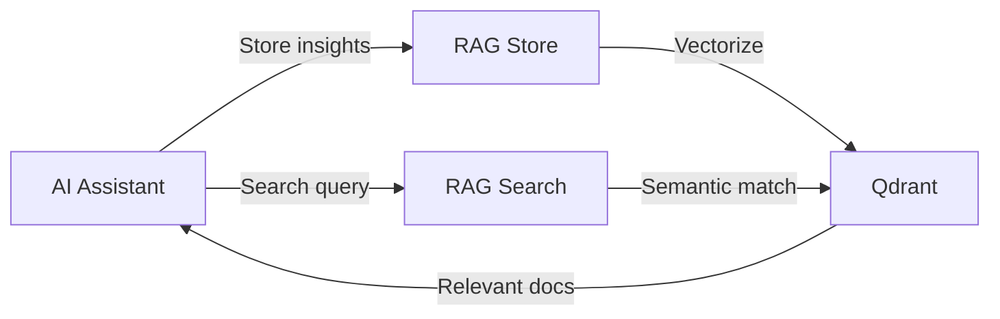

# RAG Knowledge Store

The RAG (Retrieval-Augmented Generation) Knowledge Store allows AI assistants to accumulate project understanding over time. Instead of re-learning your codebase from scratch each session, Claude can store insights, documentation, and explanations that persist across conversations.

## Overview

The RAG system provides:

- **Persistent Knowledge** — Store documentation, code explanations, and architectural insights
- **Semantic Search** — Find relevant information using natural language queries
- **Contextual Retrieval** — Get project-specific knowledge when needed
- **Multiple Collections** — Organize knowledge into separate domains (docs, architecture, conventions)
- **Custom Tools** — Define AI-friendly tool names and descriptions



## Prerequisites

Before using RAG, you need:

1. **Qdrant** — Vector database for storing embeddings
2. **OpenAI API Key** — For generating embeddings

### Start Qdrant

Using Docker:

```bash
docker run -d -p 6333:6333 -p 6334:6334 \
  -v qdrant_storage:/qdrant/storage \
  qdrant/qdrant
```

Or with Docker Compose:

```yaml
services:
  qdrant:
    image: qdrant/qdrant
    ports:
      - "6333:6333"
      - "6334:6334"
    volumes:
      - qdrant_storage:/qdrant/storage

volumes:
  qdrant_storage:
```

## Configuration

CTX supports two configuration formats: the legacy single-store format and the new multi-collection format.

### Multi-Collection Configuration (Recommended)

The new format supports multiple servers and collections, giving you fine-grained control over knowledge organization:

```yaml
rag:
  # 1. Define RAG servers (connection settings)
  servers:
    default:
      driver: qdrant
      endpoint_url: ${RAG_QDRANT_ENDPOINT:-http://localhost:6333}
      api_key: ${RAG_QDRANT_API_KEY:-}
      embeddings_dimension: 1536
      embeddings_distance: Cosine

    cloud:
      driver: qdrant
      endpoint_url: https://my-cluster.qdrant.io
      api_key: ${QDRANT_CLOUD_API_KEY}

  # 2. Define named collections (reference servers)
  collections:
    project-docs:
      server: default
      collection: myproject_docs
      description: "Project documentation and guides"
      # Optional per-collection transformer overrides
      transformer:
        chunk_size: 1000
        overlap: 200

    architecture:
      server: default
      collection: myproject_architecture
      description: "Architecture decisions and patterns"
      transformer:
        chunk_size: 2000  # Larger chunks for architecture docs
        overlap: 400

    shared-knowledge:
      server: cloud
      collection: team_knowledge
      description: "Shared team knowledge base"

  # 3. Global vectorizer settings (shared by all collections)
  vectorizer:
    platform: openai
    model: text-embedding-3-small
    api_key: ${OPENAI_API_KEY}

  # 4. Default transformer settings (can be overridden per collection)
  transformer:
    chunk_size: 1000
    overlap: 200
```

### Legacy Configuration

The original single-store format is still supported:

```yaml
rag:
  enabled: true
  
  store:
    driver: qdrant
    qdrant:
      endpoint_url: ${RAG_QDRANT_URL:-http://localhost:6333}
      api_key: ${RAG_QDRANT_API_KEY:-}
      collection: ${RAG_COLLECTION:-ctx_knowledge}
      embeddings_dimension: 1536
      embeddings_distance: Cosine
  
  vectorizer:
    platform: openai
    model: text-embedding-3-small
    api_key: ${OPENAI_API_KEY}
  
  transformer:
    chunk_size: 1000
    overlap: 200
```

::: tip Automatic Detection
CTX automatically detects which format you're using. The presence of the `store` key indicates legacy format, while `servers`/`collections` indicates the new format.
:::

### Configuration Options

#### Server Configuration

| Option | Type | Default | Description |
|--------|------|---------|-------------|
| `driver` | string | `qdrant` | Vector store backend (`qdrant`, `memory`) |
| `endpoint_url` | string | `http://localhost:6333` | Qdrant server endpoint |
| `api_key` | string | - | API key for Qdrant Cloud |
| `embeddings_dimension` | int | `1536` | Vector dimensions (must match model) |
| `embeddings_distance` | string | `Cosine` | Distance metric (`Cosine`, `Euclid`, `Dot`) |

#### Collection Configuration

| Option | Type | Required | Description |
|--------|------|----------|-------------|
| `server` | string | Yes | Reference to a named server |
| `collection` | string | Yes | Qdrant collection name |
| `description` | string | No | Human-readable description |
| `transformer` | object | No | Per-collection transformer overrides |

#### Vectorizer Configuration

| Option | Type | Default | Description |
|--------|------|---------|-------------|
| `platform` | string | `openai` | Embedding platform |
| `model` | string | `text-embedding-3-small` | Embedding model name |
| `api_key` | string | - | API key for the platform |

#### Transformer Configuration

| Option | Type | Default | Description |
|--------|------|---------|-------------|
| `chunk_size` | int | `1000` | Maximum chunk size in characters |
| `overlap` | int | `200` | Overlap between chunks |

### Environment Variables

| Variable | Description |
|----------|-------------|
| `OPENAI_API_KEY` | OpenAI API key for embeddings |
| `RAG_QDRANT_ENDPOINT` | Qdrant server endpoint |
| `RAG_QDRANT_API_KEY` | Qdrant API key (for cloud) |
| `RAG_COLLECTION` | Collection name (legacy format) |

## Custom RAG Tools

You can define custom RAG tools with meaningful names and descriptions that help AI assistants understand when and how to use them. This is done using the `type: rag` in the tools section.

### Basic Example

```yaml
tools:
  - id: project-docs-search
    type: rag
    description: |
      Search project documentation for guides, tutorials, and how-to articles.
      Use this when you need to understand how to use project features.
    collection: project-docs
    operations: [search]
```

### With Custom Name

Use the optional `name` property to set a different tool name than the `id`:

```yaml
tools:
  - id: docs-search-tool
    name: find-docs
    type: rag
    description: |
      Search project documentation for guides and tutorials.
    collection: project-docs
    operations: [search]
```

In this example, the tool will be registered as `find-docs` (not `docs-search-tool`).

### Full Example with Multiple Tools

```yaml
tools:
  # Search-only tool with custom name
  - id: project-docs
    name: search-docs
    type: rag
    description: |
      Search project documentation for guides, tutorials, and how-to articles.
      Use this when you need to understand how to use project features.
    collection: project-docs
    operations: [search]

  # Store-only tool
  - id: save-architecture
    type: rag
    description: |
      Store architecture decisions, patterns, and design rationale.
      Use when documenting important architectural choices.
    collection: architecture
    operations: [store]

  # Both operations (creates two tools: team-kb and team-kb-store)
  - id: team-kb
    type: rag
    description: |
      Search and store shared team knowledge including coding conventions
      and best practices.
    collection: shared-knowledge
    operations: [search, store]
```

### Tool Configuration Options

| Option | Type | Required | Description |
|--------|------|----------|-------------|
| `id` | string | Yes | Unique identifier for the tool |
| `name` | string | No | Tool name (uses `id` if not provided) |
| `type` | string | Yes | Must be `rag` |
| `description` | string | Yes | Description for AI (explain when to use) |
| `collection` | string | Yes | Reference to a named collection |
| `operations` | array | No | `[search]`, `[store]`, or `[search, store]` (default: both) |

### Generated Tool Names

Based on your configuration, the following MCP tools are generated:

| Configuration | Generated Tool Name |
|--------------|---------------------|
| `operations: [search]` | `{name}` or `{id}` |
| `operations: [store]` | `{name}-store` or `{id}-store` |
| `operations: [search, store]` | Both of the above |

### Benefits of Custom Tools

1. **AI-Friendly Names** — Instead of generic `rag-search`, use `search-project-docs`
2. **Clear Descriptions** — Tell AI exactly when and why to use each tool
3. **Domain Separation** — Different tools for different knowledge areas
4. **Focused Operations** — Search-only or store-only tools reduce confusion

## Default MCP Tools

When using legacy configuration (without custom tools), three default MCP tools are available:

### rag-store

Store documentation, code explanations, or insights in the knowledge base.

**Parameters:**

| Parameter | Type | Required | Description |
|-----------|------|----------|-------------|
| `content` | string | Yes | Content to store |
| `type` | string | No | Document type (see below) |
| `sourcePath` | string | No | Source path (e.g., `src/Auth/Service.php`) |
| `tags` | string | No | Comma-separated tags |

**Document Types:**

- `architecture` — System design, patterns, relationships
- `api` — API documentation, endpoints, contracts
- `testing` — Test strategies, coverage, patterns
- `convention` — Coding standards, naming conventions
- `tutorial` — How-to guides, walkthroughs
- `reference` — Quick reference, cheat sheets
- `general` — Default, general documentation

**Example:**

```
Store this insight about the authentication system:
- Uses JWT tokens with 24h expiry
- Refresh tokens stored in Redis
- Rate limiting: 100 requests/minute
```

### rag-search

Search the knowledge base using natural language.

**Parameters:**

| Parameter | Type | Required | Default | Description |
|-----------|------|----------|---------|-------------|
| `query` | string | Yes | - | Search query |
| `type` | string | No | - | Filter by document type |
| `sourcePath` | string | No | - | Filter by path prefix |
| `limit` | int | No | 10 | Maximum results (1-50) |

**Example:**

```
Search the knowledge base for "authentication flow"
```

### rag-manage

View knowledge base statistics and configuration.

**Parameters:**

| Parameter | Type | Required | Description |
|-----------|------|----------|-------------|
| `action` | string | Yes | Action to perform (`stats`) |

**Example:**

```
Show RAG knowledge base status
```

## CLI Commands

All CLI commands support the `--collection` option for multi-collection setups.

### rag:status

Display knowledge base status and configuration:

```bash
# Status for all collections
ctx rag:status

# Status for specific collection
ctx rag:status --collection=project-docs

# Output as JSON
ctx rag:status --json
```

### rag:init

Initialize a collection (create in Qdrant):

```bash
# Initialize all collections
ctx rag:init

# Initialize specific collection
ctx rag:init --collection=architecture
```

### rag:index

Bulk index files from a directory:

```bash
# Index markdown files into specific collection
ctx rag:index docs --collection=project-docs

# Index PHP files with type
ctx rag:index src -p "*.php" -t architecture --collection=architecture

# Dry run — see what would be indexed
ctx rag:index docs --dry-run

# Non-recursive
ctx rag:index docs/api --no-recursive
```

**Options:**

| Option | Short | Default | Description |
|--------|-------|---------|-------------|
| `--pattern` | `-p` | `*.md` | File pattern |
| `--type` | `-t` | `general` | Document type |
| `--collection` | `-c` | all | Target collection |
| `--recursive` | `-r` | `true` | Recursive search |
| `--dry-run` | - | `false` | Preview without indexing |

### rag:clear

Clear all entries from a collection:

```bash
# Clear specific collection
ctx rag:clear --collection=project-docs

# Clear all collections (interactive)
ctx rag:clear

# Force without confirmation
ctx rag:clear -f --collection=architecture
```

### rag:reindex

Atomic clear + reindex operation:

```bash
# Reindex documentation into specific collection
ctx rag:reindex docs -t reference --collection=project-docs

# Force reindex all collections
ctx rag:reindex docs -f
```

## Usage Patterns

### Initial Setup

1. Configure RAG in `context.yaml`
2. Start Qdrant
3. Initialize collections: `ctx rag:init`
4. Index existing documentation:

```bash
# Index your docs
ctx rag:index docs --collection=project-docs -t reference

# Index architecture docs
ctx rag:index docs/architecture --collection=architecture -t architecture
```

### During Development

As you work with Claude, it can store insights using your custom tools:

```
Use search-docs to find information about the payment system
```

```
Use save-architecture to store: The PaymentService uses the Strategy pattern 
for different payment providers. Each provider implements 
PaymentProviderInterface with process() and refund() methods.
```

### Building Knowledge Over Time

Encourage Claude to document discoveries:

- Architecture decisions → `architecture` collection
- Code patterns and conventions → `conventions` collection
- API behaviors → `api-docs` collection
- Edge cases and gotchas → `project-docs` collection

## Best Practices

### Organize by Domain

Use separate collections for different knowledge types:

```yaml
collections:
  docs:
    description: "User-facing documentation"
  architecture:
    description: "System design and patterns"
  api:
    description: "API reference and contracts"
  conventions:
    description: "Coding standards and practices"
```

### Write Clear Descriptions

Help AI understand when to use each tool:

```yaml
tools:
  - id: find-api-docs
    type: rag
    description: |
      Search API documentation for endpoint details, request/response formats,
      authentication requirements, and error codes.
      
      Use this when:
      - Looking up how to call a specific API endpoint
      - Understanding request parameters or response structure
      - Finding authentication or authorization details
    collection: api
    operations: [search]
```

### Use Meaningful Names

Choose tool names that describe the action:

```yaml
# Good - descriptive names
- id: search-architecture
  name: find-design-patterns
  
# Less ideal - generic names
- id: arch-tool-1
```

### Document Types

Use appropriate types for better retrieval:

- `architecture` — For system design, component relationships
- `api` — For endpoint documentation, request/response formats
- `convention` — For coding standards, naming patterns
- `tutorial` — For step-by-step guides

### Tags

Use tags for cross-cutting concerns:

```
Store with tags: auth, security, jwt
```

### Source Paths

Link knowledge to code:

```
Store for sourcePath: src/Payment/PaymentService.php
```

### Chunking Settings

Adjust based on content type:

- **Code explanations**: Smaller chunks (500-800 chars)
- **Documentation**: Medium chunks (1000-1500 chars)
- **Tutorials**: Larger chunks (1500-2000 chars)

## Troubleshooting

### Connection Issues

```
Error: Failed to connect to Qdrant
```

**Solution:** Ensure Qdrant is running:

```bash
docker ps | grep qdrant
curl http://localhost:6333/health
```

### Collection Not Found

```
Error: Collection "project-docs" not found in RAG configuration
```

**Solution:** Verify your collection is defined in `context.yaml`:

```yaml
rag:
  collections:
    project-docs:  # Must match the name used in tools
      server: default
      collection: actual_qdrant_collection_name
```

### Embedding Errors

```
Error: OpenAI API error
```

**Solution:** Check your API key:

```bash
echo $OPENAI_API_KEY
```

### Empty Results

If searches return no results:

1. Check if data was indexed: `ctx rag:status --collection=<name>`
2. Verify collection exists in Qdrant
3. Try broader search terms
4. Ensure you're searching the correct collection

### Dimension Mismatch

```
Error: Vector dimension mismatch
```

**Solution:** The `embeddings_dimension` must match the model:

- `text-embedding-3-small`: 1536
- `text-embedding-3-large`: 3072
- `text-embedding-ada-002`: 1536

## Architecture

The RAG system uses [Symfony AI Store](https://github.com/symfony/ai-store) as its foundation:

```
rag/
├── Config/
│   ├── RagConfig.php           # Main config (legacy + new format)
│   ├── ServerConfig.php        # Server connection settings
│   ├── CollectionConfig.php    # Collection settings
│   ├── StoreConfig.php         # Legacy store config
│   ├── VectorizerConfig.php    # Embedding settings
│   └── TransformerConfig.php   # Chunking settings
├── Console/                    # CLI commands
├── Document/                   # DocumentType, MetadataFactory
├── Loader/                     # FileSystemLoader
├── MCP/Tools/                  # rag-store, rag-search, rag-manage
├── Service/
│   ├── ServiceFactory.php      # Creates per-collection services
│   ├── IndexerService.php      # Document indexing
│   └── RetrieverService.php    # Document retrieval
├── Store/
│   ├── StoreFactory.php        # Creates Qdrant stores
│   ├── StoreRegistry.php       # Manages multiple stores
│   └── StoreRegistryInterface.php
├── Tool/
│   ├── RagToolConfig.php       # Custom tool configuration
│   ├── RagToolRegistry.php     # Manages custom tools
│   ├── RagToolFactory.php      # Creates dynamic tools
│   ├── RagToolExecutor.php     # Executes RAG operations
│   ├── DynamicRagSearchAction.php
│   └── DynamicRagStoreAction.php
├── Vectorizer/                 # VectorizerFactory
├── RagBootloader.php
├── RagParserPlugin.php
└── RagRegistry.php
```
